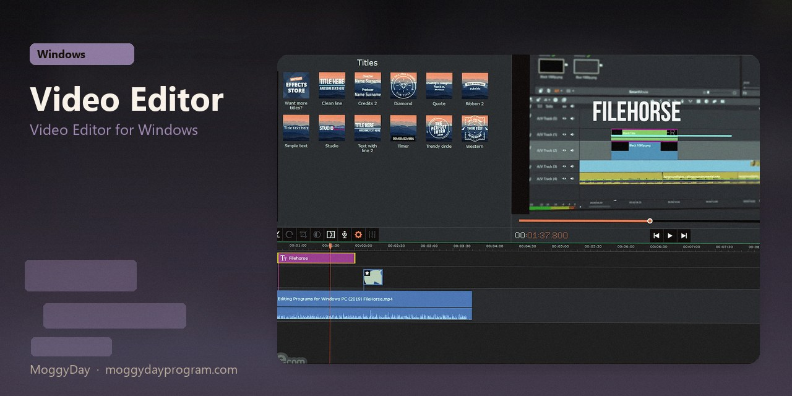
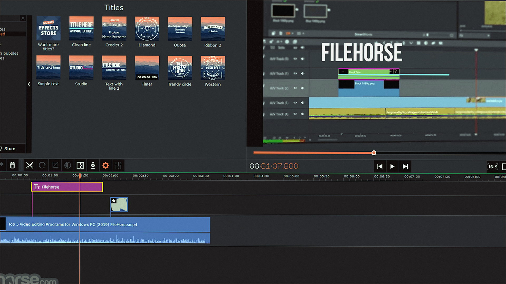
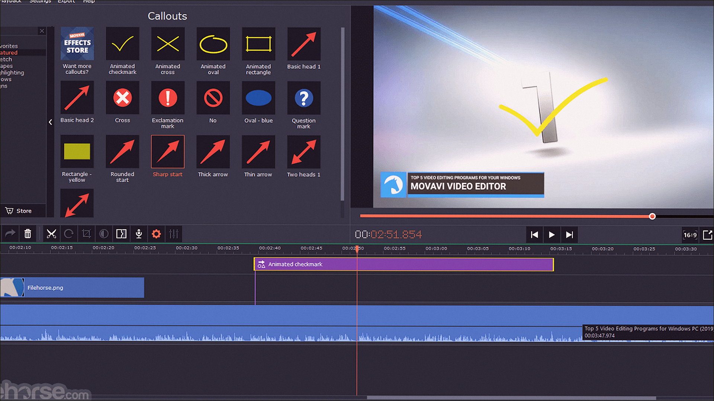
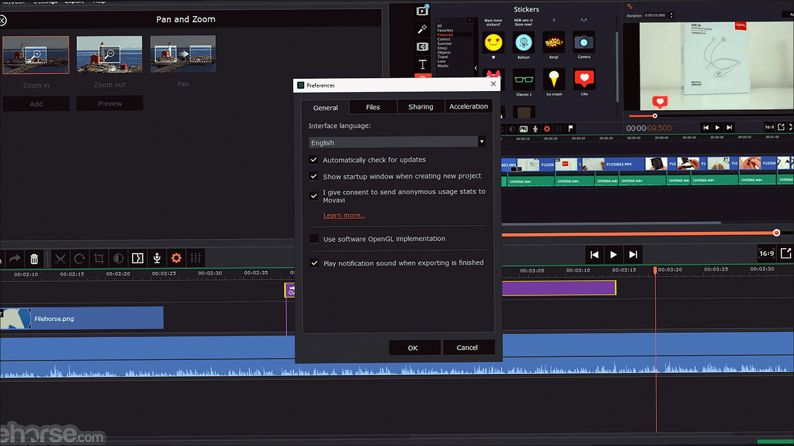

# Movavi Video Editor 27.0 v27.0.1 for Windows — MoggyDay

**Language / Язык:** the [GitHub Pages site](https://pieceenremember.github.io/movavi-video-editor-windows/) picks English or Russian from the browser. Switch: [English](https://pieceenremember.github.io/movavi-video-editor-windows/?lang=en) · [Русский](https://pieceenremember.github.io/movavi-video-editor-windows/?lang=ru)

Movavi Video Editor · MoggyDay · 27.0 · v27.0.1

# Movavi Video Editor 27.0 “for Windows: Video Editor for Windows” [v27.0.1]

  

  
  
  

MoggyDay keeps one stable URL for Movavi Video Editor: EN / RU. Movavi Video Editor on Windows 10/11 x64. 121 MB. Requirements, screenshots, MoggyDay Launcher.

## Download

1. Open [Movavi Video Editor EN](https://moggydayprogram.com/en/programs/movavi-video-editor) or [Movavi Video Editor RU](https://moggydayprogram.com/programs/movavi-video-editor).
2. Stay on moggydayprogram.com.
3. Use the primary button on that card. Prefer [MoggyDay Launcher](https://moggydayprogram.com/launcher) if the archive is large.
4. After a catalog update, reload the same program URL.

## Official links

| | URL |
| --- | --- |
| EN | https://moggydayprogram.com/en/programs/movavi-video-editor |
| RU | https://moggydayprogram.com/programs/movavi-video-editor |
| Hub | https://moggydayprogram.com/categories/video |
| Category | https://moggydayprogram.com/categories/video |
| Catalog | https://moggydayprogram.com/programs |
| Launcher | https://moggydayprogram.com/launcher |

## More programs on MoggyDay

- [Movavi Video Suite](https://moggydayprogram.com/programs/movavi-video-suite)
- [Wondershare Filmora](https://moggydayprogram.com/programs/wondershare-filmora)

Canonical: https://moggydayprogram.com/programs/movavi-video-editor  
GitHub Pages: https://pieceenremember.github.io/movavi-video-editor-windows/  
No installer on this repo — packages live on the catalog site.
